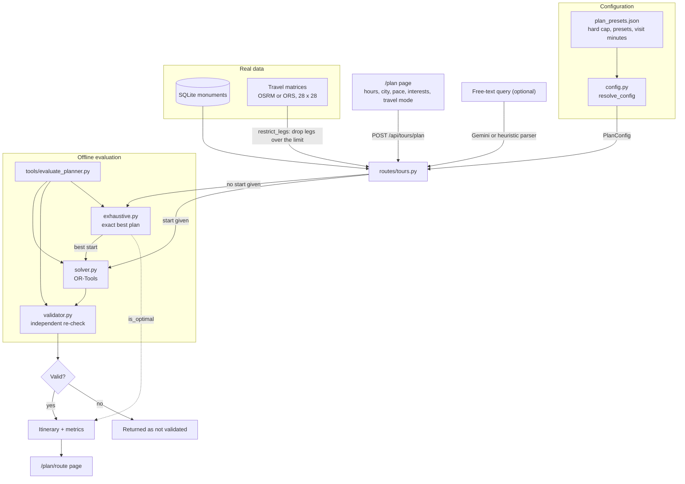

# Plan Your Day: Architecture

How a plan is built, what you can configure, and how it is checked. A plan never has more than 3 stops.



## Configuring a plan

Edit `backend/app/planner/data/plan_presets.json`. No code change is needed.

| Setting | Meaning |
|---|---|
| `hard_max_stops` | Absolute stop limit (3). A request can lower it but never exceed it. |
| `presets.<name>.max_stops` | Stops for that preset. |
| `presets.<name>.max_leg_min` | Longest allowed travel between two stops. |
| `presets.<name>.visit_scale` | Multiplies every visit time. |
| `visit_minutes.by_slug` | Visit time per monument. |
| `visit_minutes.default`, `listed_default` | Used for monuments with no entry above. |

A new preset works in the API straight away. To offer it in the UI, add it to `presets` in `frontend/app/plan/page.tsx`.

Each request can also set `preset`, `max_stops`, `max_leg_min`, `interests`, `visit_durations`, `must_visit`, `start_monument`, `profile` and `preferences.city`.

`interests` are keywords matched against a monument's name, era and style. The keyword `legend` matches monuments with a recorded legend. Each match raises that monument's priority when the planner has to choose between stops.

## Adding a location

1. Add it to `SITES` in `backend/tools/fetch_sites.py`, then run the script to resolve real OpenStreetMap coordinates.
2. Add its Hindi name to `backend/app/db/seed_data/names_hi.json` and its keywords to `MONUMENT_KEYWORDS` in `api/app/services/gemini.py`.
3. From `backend/`, run these in order:

```
python -m app.db.seed
python tools/build_matrix.py
python tools/refresh_places.py
python tools/export_catalog.py
python tools/fetch_images.py
```

4. Add the site to `SITES` in `backend/tools/fetch_images.py` before running it. It refuses to write unless every monument has a freely licensed photo. Check by eye that the photo shows the right place.
5. Add a 3D model and its marked parts to `builders` in `frontend/components/heritage/monument-models.ts`. Part descriptions live in `frontend/lib/architecture.ts`. A unit test fails until the new site has both a photo and a model.

A site added this way is **listed**: it can be planned and appears on the map, but its page says the story is pending. It becomes **verified** once `claims.json` has facts backed by two independent publishers.

The frontend bundles `frontend/lib/catalog.json`, so a new location needs the export step and a rebuild to appear. Stories, related monuments, recognition and plans are fetched live from the API.

## Evaluation

Run `python tools/evaluate_planner.py` from `backend/`. It takes about 12 minutes.

It solves 690 Delhi scenarios: 2 travel modes x 3 presets x 5 budgets x 23 start points. Each result goes through the independent validator and is compared with the exact optimum from exhaustive search.

Results from the current data:

| Metric | Result |
|---|---|
| Plans found when one exists | 100% |
| Feasible overall | 99.1% (the rest have no possible plan) |
| Passed the independent validator | 100% |
| Most stops in any plan | 3 |
| Same stops as the exact optimum, within 1 minute | 100% |
| Largest time gap from the optimum | 0.01 min |
| Matrix pairs with a route | 100% (both travel modes) |
| Matrix triangle violations over 25% | 0 |
| Mean share of the time budget used | 50.5% |
| Mean share of planned time spent travelling | 13.2% |
| 95th percentile solve time | about 1 s (the solver uses its full time limit) |

### Limits of this evaluation

- Scenarios use no interests or must-visit stops, so priority-weighted plans are covered only by unit tests.
- Agra is not in the sweep.
- Travel times are free-flow estimates from OSRM. They exclude traffic, metro, and monument opening hours and closed days.
- Plans use about half the budget on average because of the 3-stop cap, so long budgets leave spare time.
- Visit minutes in `plan_presets.json` are planning estimates, not sourced figures.
