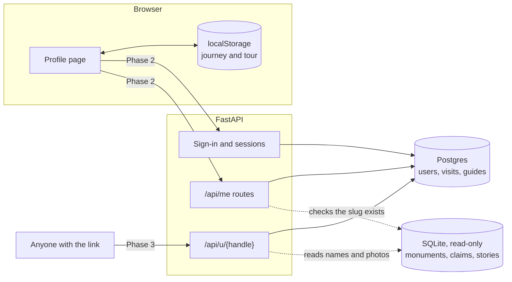
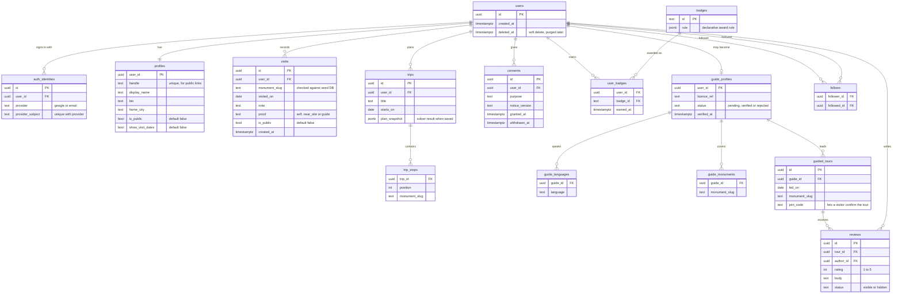

# User Profiles and Journeys: Architecture Plan

How Raahein lets a visitor or guide keep a record of the monuments they have seen, and later show it to others.

**Status:** Phase 1 is built and lives on the device only. Phases 2 to 4 are proposals that need the decisions listed under [Decisions needed](#decisions-needed).

## Principles

1. **An account is never required.** `PRODUCT.md` promises no login in the visitor flow, so identifying a monument and reading its story stay open to everyone.
2. **Private by default.** Nothing is public until the person chooses to share it, one setting at a time.
3. **Record the monument, not the person's movements.** A visit stores which monument and which date, never a GPS trail.
4. **Photos stay out of it.** `PRODUCT.md` says visitor photos are not retained. Any change to that is a separate decision.
5. **Keep user data apart from heritage data.** The monument database is rebuilt from seed files and the API opens it read-only, so it can't hold user records.

## Phases

| Phase | What people get | What it needs |
|---|---|---|
| **1. On this device (built)** | Name, visits, path map, distance, level, tour | `localStorage` only |
| **2. Accounts** | The same journey on any device, kept safe | Sign-in, Postgres, API routes, privacy notice |
| **3. Sharing** | A public profile page and shareable link | Moderation, per-field privacy, abuse reporting |
| **4. Tour guides** | Guide profile, tours led, visitor reviews | Guide verification, review rules |

Each phase ships on its own, and a phase can be dropped without undoing the ones before it.

## System structure

SQLite stays as it is. `DATABASE_URL` is already reserved for Postgres in `.env.example` but unused. Monuments live in the other database, so `visits.monument_slug` can't be a real foreign key: the API checks the slug against the seed database on every write.

## Data model

Phase numbers show when each table arrives.

### Key relationships and rules

- **A visit is one person, one monument, one date.** `UNIQUE (user_id, monument_slug, visited_on)` allows return trips and makes syncing safe to repeat. Phase 1 keeps one visit per monument, which merges cleanly.
- **A visit and a trip are different things.** A trip is a plan for the future and a visit is a record of the past. A completed stop can create a visit, but only when the person confirms it.
- **Statistics are calculated, not stored.** Distance, cities and eras come from `journeyStats` in `frontend/lib/journey.ts`. Storing them would let them disagree with the visits.
- **A review needs a real tour.** `reviews.tour_id` and a `join_code` given out by the guide mean only someone who took the tour can review it. `UNIQUE (tour_id, author_id)` allows one review each.
- **`proof` is honest about what is known.** `self` is what the person said, `near_site` means the browser reported a position close to the monument once, and `guide` means a guide confirmed it. Public pages show this label. The position used for the check is thrown away.
- **Only proven visits count towards competitive features** such as leaderboards, if those are ever added.

## API (Phase 2 and later)

| Method | Path | Purpose |
|---|---|---|
| POST | `/api/auth/{provider}` | Start sign-in |
| POST | `/api/auth/logout` | End the session |
| GET, PATCH | `/api/me` | Read or edit your profile |
| GET, POST | `/api/me/visits` | List or add visits |
| POST | `/api/me/visits/import` | Merge the visits saved on this device |
| PATCH, DELETE | `/api/me/visits/{id}` | Edit or remove a visit |
| GET | `/api/me/export` | Download everything held about you |
| DELETE | `/api/me` | Erase your account |
| GET | `/api/u/{handle}` | Public profile, showing public fields only |
| POST | `/api/guides/apply` | Apply to become a guide |
| POST | `/api/tours/{code}/join` | Confirm you took a guide's tour |
| POST | `/api/tours/{id}/reviews` | Review a tour you joined |

### Moving from device to account

1. The person signs in and sees how many visits on this device will be added.
2. The browser sends them to `/api/me/visits/import`.
3. The server checks each slug and date, then inserts with `ON CONFLICT DO NOTHING`, so repeating it is safe.
4. The browser deletes its copy only after the server confirms, so a failed request loses nothing.

## Security and privacy

- **Sessions:** `HttpOnly`, `Secure`, `SameSite=Lax` cookies with CSRF protection on writes. No tokens in `localStorage`, where any script on the page could read them.
- **Access checks:** every `/api/me` query is filtered by the session's user id, and tests confirm one user can't read or change another's records.
- **Public pages:** built from an explicit list of allowed fields. They never return email, identities, consents or private visits.
- **Abuse limits:** rate limits on sign-in, import, reviews and public profile lookups.
- **Safety:** recent visit dates reveal where someone is, so dates stay hidden on public profiles by default.
- **User text:** names, bios and reviews are rendered as plain text. Public text needs a reporting route before Phase 3 ships.
- **Deletion:** erasure hides the account immediately and purges it after a short recovery window. Reviews stay only with the author removed.

### India's Digital Personal Data Protection Act

Phase 2 makes Raahein responsible for personal data, so these need to be in place. **This list comes from background knowledge and has not been checked against the current text of the Act and its Rules. A qualified lawyer should confirm it before launch.**

- Clear notice and specific consent for each purpose, recorded in `consents`.
- Consent that is as easy to withdraw as it was to give.
- A way for people to access, correct and erase their data.
- Verifiable parental consent for anyone under 18, which is why sign-up needs an age check. The simplest launch choice is to limit accounts to adults.
- A process for reporting personal data breaches.

## Phase 1: what is built

- `/profile` shows the name, level, statistics, path map, visits, next suggestions and tour. It's excluded from search results.
- Monument pages have an "I've been here" button.
- The tour is now saved, works on phones, and sends its stops to the planner.
- Distance is the straight line between consecutive visits by date, not the distance travelled.

**Limits:** data stays in one browser, is lost if site data is cleared, and can't be shared. The profile page says so.

## Success measures

Only collect these once privacy-respecting analytics are agreed.

- Share of visitors who record a first visit, and a second one.
- Share of device journeys that become accounts after Phase 2.
- Share of profiles made public after Phase 3.
- Number of verified guides, and tours confirmed per guide, after Phase 4.

## Decisions needed

| Decision | Recommendation | Why it matters |
|---|---|---|
| Who is the main user: visitors or guides? | Visitors first, guides in Phase 4 | `PRODUCT.md` is written for visitors, while the latest request says tour guides |
| Sign-in method | Google and email one-time codes through a managed provider | Avoids storing passwords |
| Hosting for Postgres | A managed service in India | Affects cost, backups and data location |
| Minimum age | Adults only at launch | Avoids parental-consent handling |
| How guides are verified | Manual review of a government licence | Trust in the badge depends on it, and it holds sensitive documents |
| Keep visitor photos? | No | Reverses a `PRODUCT.md` promise and adds moderation and storage work |
