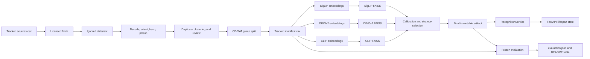

# Raahein ML Recognition

This directory contains the standalone monument-recognition pipeline for Raahein. It covers
licensed dataset curation, duplicate-safe splitting, frozen image encoders, embedding caches,
FAISS indexes, rank fusion, uncertainty calibration, startup-loaded inference, and frozen final
evaluation.

The package is deliberately named `raahein_ml`. It does not import either existing top-level
`app` package from `api/` or `backend/`.

## Current Status

The complete reusable workflow and its synthetic test suite are implemented.

The tracked catalog and manifests currently contain schemas only. A licensed image corpus has not
yet been curated, checkpoints have not been downloaded, and no real FAISS artifact or evaluation
report has been produced. Commands fail closed when required data, CUDA, checkpoints, thresholds,
or artifact hashes are missing. No placeholder recognition metrics are published.

Current local verification:

| Area | Result |
|---|---:|
| ML synthetic tests | 55 passed |
| Real-model smoke test | 1 opt-in test deselected |
| Backend tests | 83 passed |
| API tests | 14 passed |
| ML, backend, and API Ruff checks | Passed |

## What Was Created

| Capability | Implementation |
|---|---|
| Canonical labels | Loaded directly from `backend/app/db/seed_data/monuments.json` |
| Source provenance | Strict tracked catalog with licence, author, attribution, URLs, and source groups |
| Image analysis | Pillow decode, EXIF orientation, white alpha compositing, dimensions, SHA-256, and 64-bit pHash |
| Deduplication | Exact, automatic near-duplicate, manual-review, cross-label, and cross-collection handling |
| Dataset roles | Deterministic group-level `gallery`, `calibration`, `test`, and `reserve` allocation |
| Encoders | Frozen SigLIP, DINOv2, and CLIP Hugging Face adapters |
| Embeddings | L2-normalized vectors with a content-addressed local cache |
| Retrieval | Three CPU `faiss.IndexFlatIP` indexes with a shared row mapping |
| Ranking | Mean of each monument's top three references within each encoder |
| Ensemble | Equal-weight reciprocal-rank fusion with `k=60` |
| Rejection | Per-model thresholds, two-of-three fusion support, and an RRF margin gate |
| Runtime | Singleton-capable, startup-loaded `RecognitionService` with serialized CUDA inference |
| Evaluation | Frozen internal, independent-positive, and OOD evaluation with machine-readable reporting |
| CI | Python 3.12 Ruff and synthetic tests without Torch, CUDA, or checkpoint downloads |

## Architecture



The runtime path is intentionally separate from artifact creation. Production startup only loads a
finalized artifact and frozen model revisions. Calibration and artifact-writing functions are not
part of request handling.

## Package Layout

```text
ml/
  README.md
  pyproject.toml
  requirements.txt
  requirements-ci.txt
  catalog/
    sources.csv
  config/
    models.yaml
  manifests/
    manifest.csv
    duplicate_review.csv
    calibration_negatives.csv
    test_negatives.csv
    independent_test.csv
  src/raahein_ml/
    __main__.py
    cache.py
    calibration.py
    config.py
    dedupe.py
    encoders.py
    evaluate.py
    fusion.py
    images.py
    indexes.py
    manifest.py
    schemas.py
    service.py
    workflow.py
  tests/
```

| Module | Responsibility |
|---|---|
| `config.py` | Typed configuration, frozen constants, repository paths, canonical IDs, semantic hashes |
| `images.py` | Shared EXIF-aware RGB and transparency normalization |
| `manifest.py` | Catalog validation, download receipts, image scanning, splitting, CSV I/O, leakage validation |
| `dedupe.py` | pHash distance, union-find clusters, representative selection, manual-review handling |
| `encoders.py` | Lazy Torch/Transformers loading and frozen SigLIP, DINOv2, and CLIP adapters |
| `cache.py` | Atomic content-addressed `.npy` embedding cache |
| `indexes.py` | FAISS creation, checksums, finalization, loading, mapping validation, monument aggregation |
| `fusion.py` | Vector normalization, per-model ranking, and reciprocal-rank fusion |
| `calibration.py` | Single-model and jointly optimized fusion rejection gates plus fallback selection |
| `service.py` | Service lifecycle, readiness, process singleton, CUDA lock, and typed results |
| `evaluate.py` | Metrics, final-set integrity checks, latency, JSON report, and README table generation |
| `workflow.py` | GPU artifact build, calibration, negative-set validation, and final artifact verification |
| `schemas.py` | Result dataclasses, readiness snapshot, prediction trace, and typed exceptions |

## Frozen Models

Model IDs and exact Hugging Face revisions are stored in `config/models.yaml` and validated by
`config.py`.

| Strategy | Checkpoint | Revision | Dimension |
|---|---|---|---:|
| SigLIP | `google/siglip-base-patch16-224` | `7fd15f0689c79d79e38b1c2e2e2370a7bf2761ed` | 768 |
| DINOv2 | `facebook/dinov2-base` | `f9e44c814b77203eaa57a6bdbbd535f21ede1415` | 768 |
| CLIP | `openai/clip-vit-base-patch32` | `3d74acf9a28c67741b2f4f2ea7635f0aaf6f0268` | 512 |

The models are frozen. This project does not train or fine-tune them.

## Data Contract

### Canonical Monuments

The only valid positive labels are the 15 `slug` values in
`backend/app/db/seed_data/monuments.json`. Labels are never duplicated in ML source code.

Components may be preserved in manifest metadata while mapping to a coarser canonical identity.
For example, Qutb components can map to `qutb-complex`, and Jamali Kamali can map to
`mehrauli-archaeological-park`.

### Allowed Licences

Accepted images require explicit commercial-reuse-compatible provenance:

| Family | Accepted values |
|---|---|
| Public domain | `LicenseRef-Public-Domain` |
| CC0 | `CC0-1.0` |
| Attribution | `CC-BY-1.0`, `CC-BY-2.0`, `CC-BY-2.5`, `CC-BY-3.0`, `CC-BY-4.0` |
| ShareAlike | `CC-BY-SA-1.0`, `CC-BY-SA-2.0`, `CC-BY-SA-2.5`, `CC-BY-SA-3.0`, `CC-BY-SA-4.0` |

Unknown, NC, ND, stock-search, non-HTTPS, unattributed, or untraceable sources are rejected.

### Source Catalog

Add one row per image to `catalog/sources.csv`:

```text
source_id,collection,monument_id,component,source_page_url,download_url,author,license_id,license_url,attribution,source_group
```

`collection` is `curated` or `independent`. `source_group` must group a photographer burst,
capture session, album, or known repost family so related images cannot cross roles. Downloaded
files are stored under ignored `data/raw/`. Ignored download receipts bind local bytes to the
current catalog provenance.

### Image Validation

Every downloaded file is processed as follows:

1. Hash the raw bytes with SHA-256.
2. Verify and reopen it with Pillow.
3. Reject decompression bombs, corrupt files, and animations.
4. Apply EXIF orientation.
5. Composite transparent pixels onto white and convert to RGB.
6. Record oriented dimensions and reject either side below 224 pixels.
7. Compute a deterministic 64-bit perceptual hash.

The same image normalization is used by both manifest analysis and model inference.

### Duplicate Rules

| Condition | Action |
|---|---|
| Equal SHA-256 | Automatic duplicate cluster |
| pHash Hamming distance `0-4` | Automatic near-duplicate cluster |
| pHash Hamming distance `5-8` | Tracked manual review |
| Duplicate cluster spans labels | Quarantine the complete cluster |
| Duplicate cluster spans curated and independent collections | Quarantine the complete cluster |
| Valid same-label cluster | Keep the best eligible representative and retain excluded audit rows |

Manual decisions live in `manifests/duplicate_review.csv`. A changed label or pHash distance
invalidates the previous review decision. Accepted exact or near duplicates are rejected even when
they would occupy the same split.

### Deterministic Splits

OR-Tools CP-SAT assigns complete duplicate/source groups to exactly one role.

| Role | Requirement per monument |
|---|---:|
| `gallery` | Balanced `G`, where `8 <= G <= 20` |
| `calibration` | Exactly 2 |
| `test` | At least 2 |
| `reserve` | Remaining accepted images |

The solver minimizes test surplus, maximizes the balanced gallery, and uses a stable hash-based
tie-break. It runs with one worker and a fixed seed. An infeasible split fails instead of lowering
the declared requirements.

The independent positive set must contain exactly 20 images and cover all 15 monuments. Calibration
and final OOD sets contain 50 images each, split evenly between `non_target_monument` and
`everyday_scene`. Exact, near-duplicate, and provenance overlap is rejected within and across all
positive and OOD sets.

## Recognition Algorithm

### Embeddings

Each adapter uses the official Hugging Face processor and immutable revision. Models run in
`.eval()` under `torch.inference_mode()`. CUDA mixed precision is part of the artifact extraction
contract. Every output is converted to finite `float32` and L2-normalized.

Curated gallery embeddings are cached with a key derived from:

- Image SHA-256
- Model ID and revision
- Processor configuration hash
- Pooling method
- Precision and device type
- Cache schema version

Uploaded request images are never cached or written to disk.

### FAISS Retrieval

One CPU `faiss.IndexFlatIP` is built per encoder. Because vectors are normalized, inner product is
cosine similarity. All gallery rows are searched for every query.

Within each encoder:

1. Group reference hits by canonical monument ID.
2. Select the best three similarities for each monument.
3. Use their mean only to rank monuments inside that encoder.

Similarity values from different encoders are never averaged.

### Reciprocal-Rank Fusion

The three complete 15-monument rankings are combined using equal-weight RRF:

```text
score(monument) = sum(1 / (60 + model_rank))
```

The score is normalized against its theoretical maximum and returned as `fused_score`. It is not a
probability or percentage confidence. Stable monument-ID ordering resolves ties.

### Uncertainty and Fallback

Calibration uses known calibration positives and a separate 50-image OOD set. Final test labels and
results are not used for threshold selection.

Fusion accepts its winner only when:

- At least two encoders rank the fused winner first.
- Supporting encoders exceed their jointly calibrated similarity thresholds.
- The fused top-1/top-2 margin exceeds its calibrated threshold.
- Calibration OOD false acceptance is at most 5 percent, or at most 2 of 50 images.

The calibration search maximizes correct accepted known images with deterministic tie-breaking. If
fusion does not improve correct acceptance without reducing selective accuracy, the best single
encoder becomes the active strategy. A reject-all fusion gate is preserved when a valid single-model
fallback exists. Finalization fails when no strategy has a nontrivial viable gate.

## Artifact Contract

Generated files are ignored and stored under `data/artifacts/`:

```text
data/artifacts/<artifact-id>/
  metadata.json
  mapping.jsonl
  siglip.faiss
  dinov2.faiss
  clip.faiss
```

The artifact ID is content-addressed from finalized metadata. Metadata records:

- Manifest, source catalog, configuration, and canonical-monument hashes
- Exact model IDs, revisions, dimensions, preprocessing, and extraction settings
- Shared row mapping and per-class gallery counts
- Index and mapping checksums
- Aggregation and RRF configuration
- Single-model and fusion rejection gates
- Calibration input hashes and measured calibration outcomes
- Active operational strategy
- Relevant dependency versions

Loading refuses non-final artifacts, checksum failures, stale manifests/catalogs, mapping changes,
model or processor mismatches, incorrect dimensions/counts, non-normalized vectors, missing classes,
or unsafe artifact paths.

## Service Architecture

`RecognitionService` has four states: `new`, `starting`, `ready`, and `failed`.

`start()` performs the following once per process:

1. Resolve and validate one finalized artifact.
2. Verify it against the current tracked gallery and source catalog.
3. Load all three frozen encoders.
4. Warm each encoder with an in-memory image.
5. Publish readiness only after successful validation and warmup.

CUDA encoder calls are protected by a process-local lock. CPU FAISS search operates on immutable
indexes after embedding extraction. Run one application worker per GPU. Infrastructure failure
raises a typed error; only a completed low-evidence prediction returns `status: "uncertain"`.

## Installation

### WSL2 CUDA Runtime

Run from the repository root:

```bash
python3.12 -m venv .venv
source .venv/bin/activate
python -m pip install --index-url https://download.pytorch.org/whl/cu124 torch==2.5.1
python -m pip install -e './ml[gpu,test]'
export HF_HOME="$PWD/data/cache/huggingface"
```

Production uses CUDA for encoders and CPU for FAISS. CUDA is never silently replaced with CPU.

### CPU Development

CPU execution is only for explicit development and synthetic work:

```bash
export RAAHEIN_ML_DEVICE=cpu
export RAAHEIN_ML_ALLOW_CPU=true
python -m pip install -e './ml[test]'
```

Do not use CPU-built extraction artifacts as production CUDA artifacts. Device type, precision, and
preprocessing are validated during artifact loading.

### CI Dependencies

```bash
cd ml
python -m pip install -r requirements-ci.txt
```

The CI dependency set includes FAISS, NumPy, Pillow, OR-Tools, PyYAML, HTTPX, pytest, and Ruff. It
does not install Torch or Transformers.

## Configuration

The default frozen configuration is `config/models.yaml`.

Supported environment overrides:

| Variable | Purpose |
|---|---|
| `RAAHEIN_ML_CONFIG` | Alternate `models.yaml` path |
| `RAAHEIN_ML_ARTIFACT_DIR` | Artifact directory or artifact root |
| `RAAHEIN_ML_DEVICE` | `cuda`, a CUDA device, or explicit development `cpu` |
| `RAAHEIN_ML_ALLOW_CPU` | Must be `true` before CPU execution is allowed |
| `HF_HOME` | Ignored Hugging Face checkpoint cache |
| `HF_TOKEN` | Optional Hugging Face access token |

Tracked configuration paths must remain repository-relative. Local artifact overrides may be
absolute.

## End-to-End Workflow

Run commands from the repository root after installing the package.

### 1. Curate Provenance

Populate:

```text
ml/catalog/sources.csv
ml/manifests/calibration_negatives.csv
ml/manifests/test_negatives.csv
```

Use verified canonical IDs, explicit compatible licences, stable HTTPS source pages, complete
attribution, and conservative source groups.

### 2. Download Sources

```bash
python -m raahein_ml.manifest fetch
```

Downloads are atomic. Existing bytes are reused only when an ignored receipt matches both the
current source contract and local SHA-256.

### 3. Scan and Review Duplicates

```bash
python -m raahein_ml.manifest scan
```

The scan writes ignored drafts under `data/cache/`, refreshes
`ml/manifests/duplicate_review.csv`, and never overwrites a validated final manifest. Resolve every
blank review decision using `same` or `different` and record the reviewer.

### 4. Build Final Manifests

```bash
python -m raahein_ml.manifest build
python -m raahein_ml.manifest validate --rehash
```

Build rescans the source bytes, applies duplicate decisions, solves group-safe roles, verifies every
fingerprint, and atomically replaces tracked manifests only after all checks pass.

### 5. Fetch Frozen Checkpoints

```bash
python -m raahein_ml fetch-models
```

This downloads the exact revisions from `config/models.yaml` into the configured Hugging Face
cache.

### 6. Build Embeddings and Indexes

```bash
python -m raahein_ml build
```

This revalidates the complete positive corpus, embeds balanced gallery rows, uses or refreshes the
ignored embedding cache, and writes three indexes to `data/artifacts/.staging`.

### 7. Calibrate and Finalize

```bash
python -m raahein_ml calibrate
```

Calibration rehashes positive and OOD inputs, verifies complete disjointness, jointly searches the
fusion gate, selects fusion or the best single-model fallback, freezes final-set hashes, and moves
the staging directory to `data/artifacts/<artifact-id>`.

### 8. Validate the Final Artifact

```bash
python -m raahein_ml validate --artifact data/artifacts/<artifact-id>
```

The command prints the validated artifact ID.

### 9. Run the Real-Model Smoke Test

```bash
python -m raahein_ml smoke --artifact data/artifacts/<artifact-id>
```

By default, smoke testing uses the first accepted gallery image. Pass `--image PATH` to use another
local image. The command loads and warms all models before returning a JSON recognition result.

### 10. Run Untouched Final Evaluation

```bash
python -m raahein_ml evaluate \
  --artifact data/artifacts/<artifact-id> \
  --update-readme
```

Evaluation verifies that manifests and raw bytes match the hashes frozen during calibration. It
does not rewrite artifact thresholds or strategy selection. The default report is written to
`ml/reports/evaluation.json`. Protected manifest, config, README, and artifact paths cannot be used
as report destinations.

## Evaluation Outputs

All four strategies are evaluated: SigLIP, DINOv2, CLIP, and equal-weight fusion.

Positive datasets report:

- Top-1
- Top-3
- Recall@5
- Accepted coverage
- Correct acceptance
- Selective accuracy among accepted predictions
- Known-photo false-rejection rate

The 50-image final OOD set reports rejection and false acceptance overall and separately for
non-target monuments/buildings and everyday scenes. An `uncertain` positive result retains its full
ranking for Top-k metrics.

The report also records sample counts, artifact and manifest hashes, model revisions, gates, active
strategy, startup/warmup time, warm p50/p95 latency, Python/platform information, CUDA runtime, and
GPU name when available.

## Python Service Contract

Create and warm the service in application lifespan, after worker creation:

```python
from contextlib import asynccontextmanager

from fastapi import FastAPI
from raahein_ml.config import load_config
from raahein_ml.service import RecognitionService


@asynccontextmanager
async def lifespan(app: FastAPI):
    recognition = RecognitionService(load_config())
    recognition.start()
    app.state.recognition = recognition
    yield


app = FastAPI(lifespan=lifespan)
```

Inference accepts a decoded Pillow image:

```python
result = app.state.recognition.identify(image)
payload = result.to_dict()
readiness = app.state.recognition.readiness.to_dict()
```

Representative result:

```json
{
  "status": "identified",
  "strategy": "fusion",
  "candidates": [
    {
      "monument_id": "taj-mahal",
      "rank": 1,
      "ranking_score": 0.93,
      "fused_score": 0.93,
      "model_ranks": {
        "siglip": 1,
        "dinov2": 2,
        "clip": 1
      }
    }
  ],
  "artifact_version": "<artifact-id>"
}
```

`ranking_score` and `fused_score` are ranking values, not probabilities.

Typed failures:

| Error | Meaning |
|---|---|
| `ConfigurationError` | Runtime, checkpoint, device, or frozen configuration is invalid |
| `ArtifactError` | Artifact is missing, corrupt, stale, or incompatible |
| `NotReadyError` | Inference was requested before successful startup |
| `InferenceError` | A loaded encoder or index failed during inference |

A valid low-evidence prediction returns HTTP-success-compatible `status: "uncertain"` with up to
three candidates. Infrastructure failure must become a server error, not uncertainty.

HTTP multipart parsing, MIME and size validation, rate limiting, and mapping typed failures into the
API's existing error envelope remain backend responsibilities.

## Testing

Fast tests require no checkpoints, network, Torch, or CUDA:

```bash
cd ml
ruff check src tests
pytest -q -m 'not real_model'
```

The synthetic suite covers configuration, licensing, corrupt images, EXIF/transparency handling,
pHash determinism, duplicate clusters, manual-review invalidation, deterministic splits, leakage,
embedding cache corruption, FAISS integrity, full-gallery search, top-three aggregation, RRF,
joint calibration, single-model fallback, uncertain results, singleton startup, concurrent CUDA
serialization, metrics, report generation, protected outputs, and build workflow orchestration.

The opt-in real-model test requires a finalized artifact and a local image:

```bash
export RAAHEIN_ML_SMOKE_ARTIFACT=data/artifacts/<artifact-id>
export RAAHEIN_ML_SMOKE_IMAGE=/path/to/image.jpg
pytest -q -m real_model
```

## Failure-Safe Behavior

- No implicit CPU fallback in production.
- No model or artifact loading at Python import time.
- No request-time image persistence.
- No cross-model similarity averaging.
- No final-test threshold tuning.
- No manifest replacement after a failed scan or build.
- No artifact readiness when hashes, dimensions, counts, checksums, or thresholds differ.
- No placeholder evaluation metrics.
- No tracked raw images, embeddings, model weights, or binary indexes.

## Remaining Operational Work

The implementation is ready, but completing a real recognition release still requires:

1. Curate and review enough licensed images for all 15 monuments.
2. Populate two disjoint 50-image OOD manifests and the 20-image independent positive set.
3. Run the manifest workflow and resolve every manual duplicate review.
4. Download the three frozen checkpoints on the WSL2 CUDA host.
5. Build and calibrate a finalized artifact.
6. Run the real-model smoke test and untouched evaluation.
7. Track the generated `ml/reports/evaluation.json` and generated root README results table.

Until these steps are complete, the header-only manifests intentionally fail strict validation.
